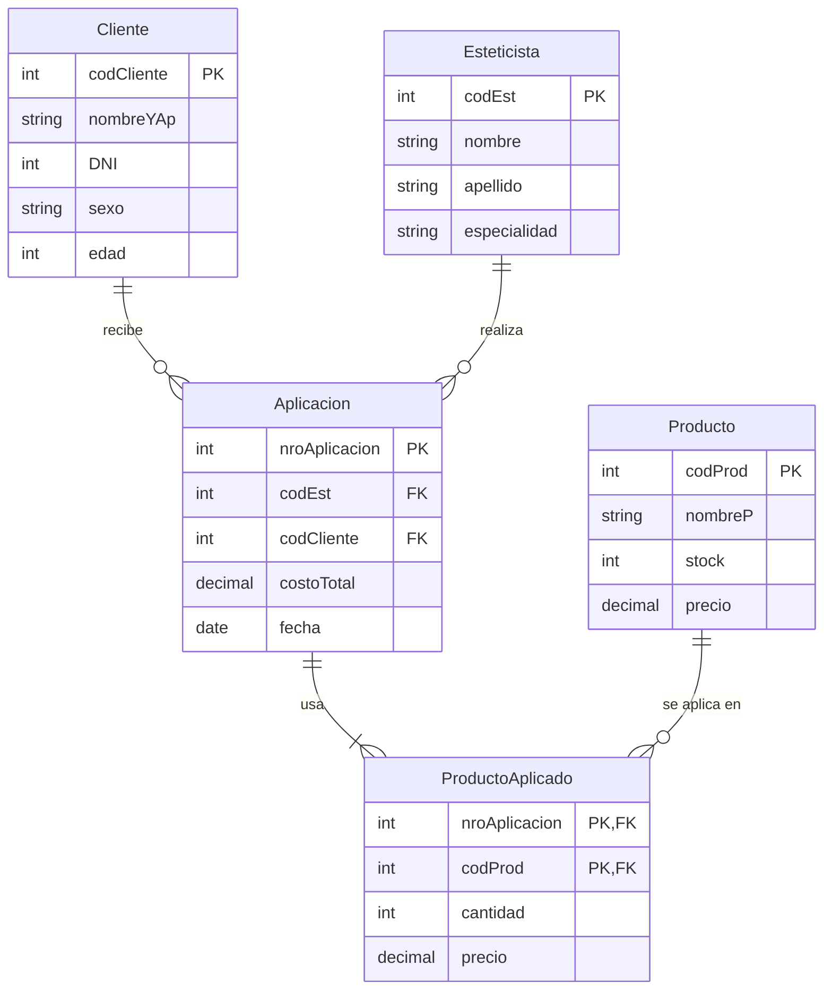
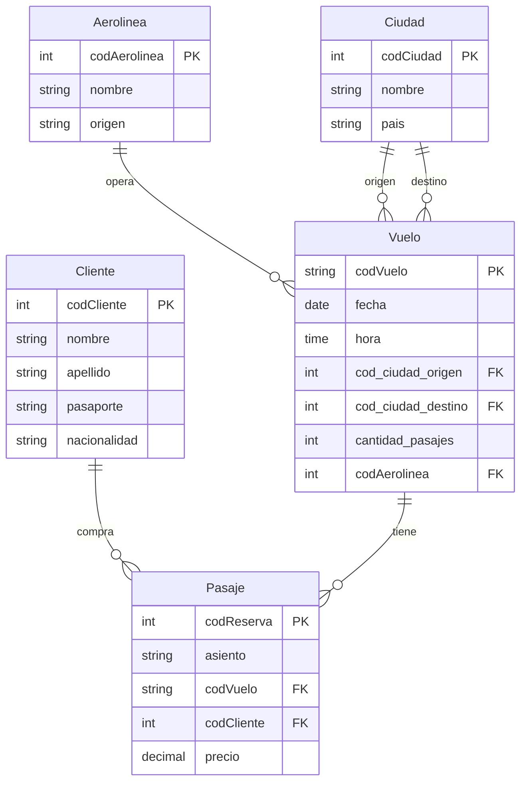

# Consultas SQL · Introducción a Base de Datos

Resolución ejecutable de la **Práctica 5 (SQL)** de *Introducción a Base de Datos*, Licenciatura en Ciencia de Datos en Organizaciones (UNLP).

En la cursada las consultas se resuelven en papel. Acá pasé dos de los ejercicios a una base de datos real: creé las tablas, cargué datos de ejemplo y ejecuté cada consulta para comprobar que devuelve lo que pide el enunciado. En el camino corregí los errores que tenía mi resolución original; cada notebook explica qué cambió y por qué.


## Ejercicios

| Ejercicio | Notebook | Qué practica |
|-----------|----------|--------------|
| Centro de estética | [`centro_estetica.ipynb`](notebooks/centro_estetica.ipynb) | `JOIN`, `LEFT JOIN` para contar ceros, subconsultas con `IN` y `NOT IN`, `INTERSECT`, división con doble `NOT EXISTS`, `GROUP BY` con `HAVING` y `>= ALL`, `UPDATE` |
| Vuelos | [`vuelos.ipynb`](notebooks/vuelos.ipynb) | `JOIN` de una misma tabla dos veces (ciudad de origen y de destino), `HAVING` para detectar sobreventa, `UNION`, `INTERSECT`, `NOT EXISTS`, `DELETE` respetando claves foráneas |

Cada notebook muestra, para las diez consultas, el enunciado, el SQL y el resultado sobre los datos de ejemplo. Al final hay algunas versiones originales ejecutadas para ver qué fallaba, por ejemplo un promedio que contaba clientes repetidos o un `> ALL` que nunca devolvía nada.

### Centro de estética



### Vuelos



## Estructura

```
├── consultas.py               # crea la base y ejecuta las consultas
├── notebooks/
│   ├── centro_estetica.ipynb
│   └── vuelos.ipynb
└── sql/
    ├── centro_estetica/
    │   ├── 01_esquema.sql     # CREATE TABLE con claves primarias y foráneas
    │   ├── 02_datos.sql       # datos de ejemplo
    │   └── 03_consultas.sql   # las 10 consultas
    └── vuelos/
        ├── 01_esquema.sql
        ├── 02_datos.sql
        └── 03_consultas.sql
```

Los archivos `.sql` usan la misma sintaxis que se ve en la cátedra, por ejemplo `YEAR()` para obtener el año de una fecha. Los notebooks los cargan en **DuckDB**, una base de datos que corre en memoria desde Python, sin instalar ningún servidor.

## Cómo ejecutarlo

```bash
python -m venv .venv
# Windows: .venv\Scripts\activate   ·   Linux/Mac: source .venv/bin/activate
pip install -r requirements.txt
jupyter notebook
```

Después abrir la carpeta `notebooks/` y ejecutar cualquiera de los dos notebooks de principio a fin.

## Aclaraciones

Los esquemas y los enunciados son de la Práctica 5 de la cátedra. Los datos son inventados: los armé para que cada consulta tenga casos que la pongan a prueba, como un producto que nunca se aplicó, un vuelo con más pasajes vendidos que su capacidad o una aerolínea que vuela fuera del país.

---

Lautaro Pennetta · Ciencia de Datos en Organizaciones, UNLP
